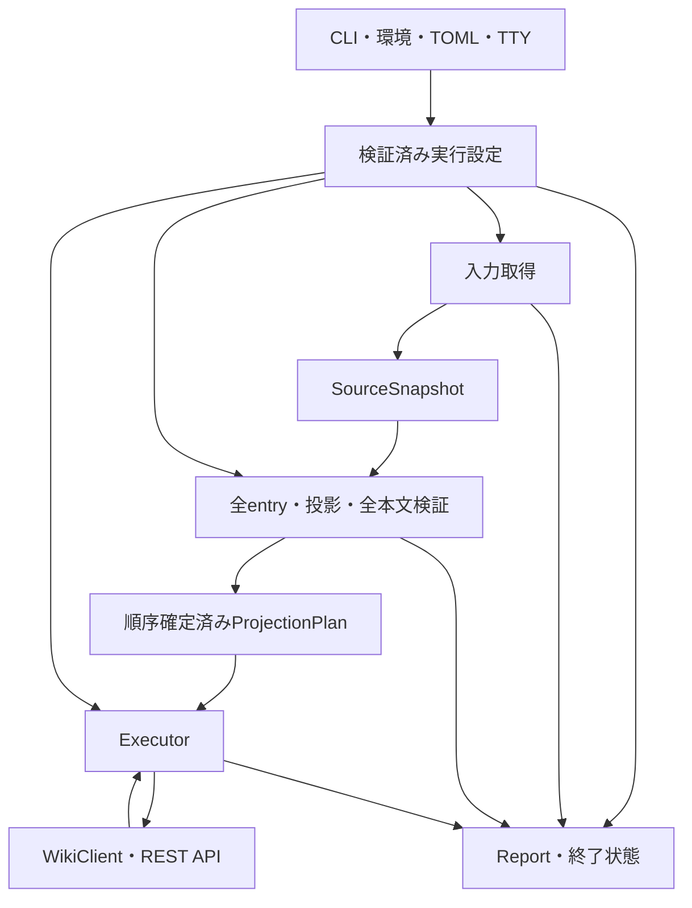

# 基本設計書

## 1. 文書の位置付けと対象

本書は`kwgt/luwiki`向けページインジェクターの製品全体について、
構成、データ契約、処理順序、安全性、失敗処理と検証方針を定義する。
要求仕様を最優先とし、CLI構文と設定値の詳細は
[REQUIREMENTS.md](REQUIREMENTS.md)、[CLI_SPECS.md](CLI_SPECS.md)、
[CONFIG_SPECS.md](CONFIG_SPECS.md)に従う。

本文は製品の設計契約を述べ、現在の実装到達範囲は第11節で区別する。
構成・安全性・障害時の判断は文書内で定義し、関連仕様への対応を第12節に示す。

初期版は通常ZIP/ZIP64、ローカルGit、HTTPSリモートGit、
GitHub `owner/repo`と、`error`・`update`・`overwrite`を対象とする。
用途はWiki初期ページとAIエージェント向けハーネス等の取り込みである。
アセット投入、SSH・credential helper、自動ロールバック、
原子的overwrite、front matterのバージョン比較は初期版に含めない。

## 2. 構成と責務

| 境界 | 責務 | 技術・配置 |
| --- | --- | --- |
| 入力収集・設定解決 | 優先順位、排他、URL・認証・上限の検証 | clap、url、directories、`cmd_args` |
| 入力取得 | 四方式取得、参照解決、固有検査、snapshot・専用領域所有 | zip、gix、octocrab、`source` |
| 共通検証 | 全entry名、投影、重複・件数・全対象本文検証、不変保管 | `validation` |
| 計画 | 全件検証済み入力の所有、決定的順序、ページと本文の対応 | `projection` |
| WikiClient | HTTP認証、単発要求、応答・ID・本文・metadata・ロックの型付け | reqwest、tokio |
| Executor | 計画順処理、衝突モード、比較、ロック、再照合、停止 | 実行制御 |
| 報告・ログ | 結果・警告・失敗・復旧情報、終了状態、安全な表示 | `report`、`logging`、env_logger |

設定解決は入力内容検査やWiki操作を行わない。取得は共通本文検証済みを
表明しない。WikiClientはモード判断、自動再送、複数ページの順序を持たず、
Executorが進行判断を所有する。本文比較は独立した純粋な責務とし、
初期版はUTF-8バイト列の完全一致を用いる。

単発クライアントの型・逐次受信・ロック資源・失敗の詳細は
[WIKI_CLIENT_DESIGN.md](WIKI_CLIENT_DESIGN.md)に定める。

## 3. 主なデータ契約

| 型・所有者 | 契約 |
| --- | --- |
| `ResolvedRunConfig` | 採用済み接続先・秘匿認証・prefix・モード・上限・絶対期限・入力指定・警告 |
| `SourceSpec` | 四方式を排他的に表し、Git参照方針を持つ |
| `Secret` | Debug/Displayへ秘密値を出さず、必要な認証境界だけで値を使用する |
| `SourceSnapshot`・`SourceEntry` | 取得済み本文、生相対名、File/Directory、実サイズ、安全な入力参照。共通検証前 |
| `ProjectedInput` | 全entry名・投影・重複・件数検査済み。本文は未検証 |
| `ValidatedInput`・`ValidatedPage` | 全共通検証済み。識別子・実サイズ・専用本文領域を所有するが順序未確定 |
| `ProjectionPlan`・`PlannedPage` | 順序付き識別子・実サイズ・本文参照と検証済み本文の寿命を所有する |
| `PageIdentity` | 検証済み絶対`PagePath`と、入力方式・相対entry名だけの`SourceReference` |
| `Report` | 計画成立の有無、順序付きページ結果、警告、分類済み失敗 |

計画の生成経路は全件検証済み入力に閉じる。任意metadata・未検証本文
から構築するAPIを設けない。計画は`ValidatedInput`を所有することで
既存の`PayloadLease`を引き継ぎ、本文を再コピーしない。
`PlannedPage`の元検証済み位置を識別子・実サイズと一体で整列する。
計画位置から元位置へ写して読込専用本文APIへ委譲し、本文使用中は
計画を生存させる。フィールドは非公開、書込・複製APIは設けない。
計画Debugは件数、ページDebugはサイズだけに限定する。
`Secret`をReport・ページ結果・復旧情報・アプリケーションエラーへ渡さない。

## 4. 全体処理フロー

1. CLIを収集する。help/versionは正常表示して終了する。
2. TOML構文・型・未知キーを検証し、優先順位・排他条件から
   実行設定を確定する。起動警告を保持する。
3. 入力を取得し、方式固有の全entry検査・上限判定後、
   元入力から独立した取得済み本文を所有するsnapshotを生成する。
4. 全entry名、投影、重複・件数と全Markdown本文を検証し、
   成功した本文を専用領域へ保管する。部分結果を公開しない。
5. 全件検証済みページを深さ→絶対パスのUTF-8バイト列辞書順に整列し、
   最終停止確認後に計画を確定する。
6. Executorが計画順にWiki存在・本文・metadataを読み取り、
   衝突モードに応じた操作を行う。
7. 最初の失敗で後続を未実行にし、先行成功を維持してReportを確定する。

計画確定前にWiki要求を発行しない。存在確認を含む読み取りと
最初のPOST/PUT/DELETEは全件検証・順序確定後に限る。
対象0件は全入力の必要な安全検査成功後だけ正常な空計画となる。

## 5. 入力取得・投影と安全上限

### 5.1 入力指定とGit参照

自動判別は実在ローカルパス、HTTPS URL、厳格な`owner/repo`の順。
小文字`.zip`の通常ファイルとGit worktreeをローカル入力とし、bareを拒否する。
HTTPS Git URLはホスト・repoパスを許容し、userinfo・query・fragmentを拒否する。
資格情報をURLへ埋め込まない。

Gitの既定はmain、なければmasterとする。remote HEAD・GitHub default branchを
優先しない。branch/tag/commitは相互排他で、ローカル専用`--worktree`とも併用しない。
既定はコミット済みツリー、worktreeは追跡済み変更とignore対象外の未追跡を含め、
削除済み・ignoredを除外する。全入力のsymlinkとGit submodule/gitlinkを拒否する。

### 5.2 ZIP/ZIP64

ファイル全体の圧縮後サイズを解析前に検査する。中央directoryのraw bytesから
EOCD/ZIP64 EOCD・locator、件数、offset・長さ・整数overflow、extra fieldと
領域整合を確認する。公開ZIP APIのentry数・生名・metadataとraw記録を照合し、
中央/local headerと必要なdata descriptorの整合を検査する。
重複、危険名、symlink、破損、検証不能な形式を拒否する。

全entry名は厳格UTF-8とし、非ASCII名にはbit 11を必須とする。
ASCIIのみなら必須としない。directory末尾slashは種別記号として1個だけ
除いて検査し、Fileの末尾slashや複数末尾slashを拒否する。
宣言展開量とchunk実読込量の双方に上限を適用し、非Markdownも
全entry件数・展開量・必要な安全検査の対象とする。
通常ZIPと小規模ZIP64を必須とし、巨大・特殊形式は試験範囲と未実証範囲を区別する。
安全に検証できない形式を対応済みと表示しない。

### 5.3 Git/GitHub取得

Git内容はgix、GitHub repo/ref確認はoctocrabで取得する。
GitHubのrepo/ref/commit確認後は固定commitをgixへ渡し、API確認と
内容取得の間のref移動による不一致を避ける。資格情報は確認済みの
同一GitHub HTTPS host・既定port・repoに限定し、永続helperを使わない。
`GITHUB_TOKEN`だけをGitHub HTTPSの限定されたメモリ内資格情報境界で使用する。
Wiki認証や通常HTTPS Gitへ流用せず、URL・永続Git設定・ログ・エラーへ保存しない。
専用領域をfetch後・checkout前に計量し、checkout後も再確認する。
進捗から協調停止を試みるが、通信・領域の取得中一時超過は許容する。
取得後判定を厳密な通信量制限とは扱わない。

### 5.4 共通検証と不変本文

四方式に共通してソース最上位の小文字`root/`を取込directoryとする。
root不在や通常fileのrootは入力エラーにし、ソース全体へのfallbackをしない。
ZIPは明示directory entryがなくても配下entryからroot存在を認識する。
worktreeでは実在する空rootも検査する。安全検査後に対象Markdownが0件なら空計画を返す。

全entry生相対名をlossy変換せず検査する。厳格UTF-8、U+FFFD、空白・制御文字・
NUL、絶対名、空segment、dot/dot-dot、backslashを検査し、raw重複を拒否する。
prefixと投影後絶対パスも再検証する。root外をページ候補から除外し、
先頭の`root/`一段と小文字`.md`の最後の拡張子だけを除いてprefixへ結合する。
root内の`.md`・`dir/.md`の空投影名を拒否する。元SourceReferenceはrootを含む名前を保持する。
取込root、単独directory、Markdownのない親ページを生成せず、最終パスの重複・件数を検査する。
root外はページ本文検証/ページ件数/本文上限の対象外だが、全ソースの安全検査と
ZIP/Gitの全量上限、取得時のIOまで対象外にする保証ではない。

全対象本文を取得済みsnapshotから読み、実量・metadata整合、厳格UTF-8・U+FFFDを検証する。
非Markdown本文のUTF-8を新たな制約にしない。BOM、LF/CRLF、末尾改行、Unicode表記を
変換しない。本文は連番fileへ保管し、全件を常時メモリに載せず、検証時も
1ページ分だけを上限内で保持する。成功後source領域を解放し、
元入力の後続変更に依存せず、保管済み本文だけを使う。

Wikiから受け取る既存本文・JSON・エラー応答は固定受信量上限を追加せず、
逐次処理と共通期限・取消で管理する。入力max_page_bytesを流用しない。
必要な本文と解析stateを専用領域へ保管し、全応答をメモリに保持しない。
アプリケーションの作業メモリとtransport内部bufferを区別し、絶対RSS上限は保証しない。

### 5.5 上限の適用

| 設定キー | 対象・時点 |
| --- | --- |
| `max_pages` | root内の投影対象件数、計画成立前 |
| `max_page_bytes` | root内の対象Markdown本文の実読込量 |
| `max_zip_entries` | 全raw中央entry件数、展開前 |
| `max_zip_compressed_bytes` | header・中央directory・extraを含むZIPファイル全体 |
| `max_zip_uncompressed_bytes` | 全entry宣言展開量合計と実読込量合計 |
| `max_git_bytes` | Git取得専用領域、checkout・Wiki書込前 |
| `max_processing_seconds` | 設定解決で定めた同一絶対期限を取得・検証・計画・Wiki Executor/HTTPで共有 |
| `max_http_concurrency` | HTTP送信境界の同時要求上限 |

既定値・許容範囲はCONFIG_SPECSを唯一の値の定義元とする。
初期版のページ処理・変更HTTPは直列、実同時要求数は1とする。
HTTP上限2〜4はページ書込の並列実行を約束しない。

## 6. 停止・所有権と非原子性

取得・投影・本文検証・計画確定は同一`StopContext`の絶対期限と取消を共有する。
Wiki ExecutorとHTTPも実行設定の同一絶対期限までの残時間を用い、
phase間で時間上限をリセットしない。
期限・取消到達後は再照合・自分の既存ロック解放を含む追加HTTPを行わず、
別の後処理猶予を設けない。確認できない状態は推測せず確定情報を報告して停止する。
同じ期限で別contextを生成しても取消共有にはならない。HTTPはTokio非同期側、
ZIP/Git同期I/O・走査はblocking側で扱い、gixの非Send準備値は準備から
fetch/checkoutまで同一closureへ閉じる。

phase・chunk・Git進捗境界で協調停止を確認する。期限超過時は取消を通知して
blocking workerの終了を待ち、worker所有領域を先に回収しない。
future破棄は取消通知であり、即時停止・回収を保証しない。leaseはRAIIで回収し、
本文使用中は所有者を生存させる。途中失敗で未完成snapshot・検証結果・計画を公開しない。

複数ページ処理とoverwriteは原子的ではない。先行成功はロールバックしない。
DELETE後に止まると旧ページが削除されたままになる。Wikiの部分変更とローカル領域回収を
区別し、自動復元・再送を行わず、確定事実だけを復旧情報へ残す。

## 7. 設定・認証

CLIは`luwiki-injector [OPTIONS] PAGE-SOURCE [TARGET-SERVER]`。
対象URLは位置引数→`LUWIKI_URL`→`server.url`→`https://localhost:8080`の順。
Wiki URLはHTTP/HTTPS・ホスト必須、userinfo・query・fragment・ルート以外のパスを拒否する。

Wiki認証はBasicかBearerの一方で、CLI→環境→TOML→条件付きTTYの順に値を採用する。
両方式同時指定、完全未指定、Basicパスワードだけの指定を拒否する。
TTY対話はBasicユーザー名が確定し、パスワードだけが不足する場合に限る。
非TTYでは対話しない。環境は`LUWIKI_USER`・`LUWIKI_PASSWORD`・`LUWIKI_TOKEN`。
GitHub tokenはWiki認証と分離し、CLI・TOMLでは受け付けない。

TOMLは明示パス、なければXDG設定領域の`luwiki/config.toml`を探索する。
既定file不存在は正常、明示file読込失敗はエラー。
構文・型・未知キーは採用有無にかかわらず検証し、意味検証は採用した値だけに行う。
prefixとmodeはCLI→TOML→既定値で解決する。
CLI秘密値直接指定と、認証情報を含む設定fileのgroup/other読取権限は警告とする。
秘密値を警告文へ出さず、権限警告だけで設定読込を拒否しない。

## 8. Wiki RESTとページ状態遷移

本節はインジェクターの単発API契約と状態遷移を定義する。
単発APIの詳細は第12節に記載する固定revisionのLuWiki REST仕様を参照する。

Wiki専用HTTP clientはGETを含めリダイレクトを自動追従せず、3xxを単発失敗とする。
ライブラリ既定のprotocol NACK再送も無効にし、自動再試行・暗黙再送を行わない。

### 8.1 単発操作契約

| 用途 | API・正常結果 | Bearer scope |
| --- | --- | --- |
| pathの有効ID | `GET /api/pages/id?path=...` → 200 ID | `read` |
| 本文・metadata | `GET /api/pages/{id}/source`・`meta` → 200 | `read` |
| ドラフト作成 | `POST /api/pages?path=...` → 201 ID・ロック | `create` |
| ロック取得・延長 | `POST`/`PUT /api/pages/{id}/lock` → 204ロック | `create`または`update` |
| 本文登録・更新 | `PUT /api/pages/{id}/source` → 204 | `update` |
| ロック解除 | `DELETE /api/pages/{id}/lock` → 204 | `update` |
| ページ削除 | `DELETE /api/pages/{id}` → 204 | `delete` |

create/update/deleteはreadを暗黙包含しない。writeはread/create/update/delete等を
包含する上位互換scopeであり、BasicのReadOnly属性による書込禁止は独立する。
全modeの通常遷移を許可する集合はread/create/update/delete、またはwriteとなる。
実際に必要なscopeは発行する操作による。同一skipや既存error拒否にdeleteまで
一律要求する製品検査は設けず、クライアントは認証値からscopeを推測しない。
Bearerのpath prefix制約と独立したロックtoken認証もサーバーで判定される。
POSTは本文なしのドラフトとロックを同一transactionで作る。
`X-Page-Lock`の期限・tokenを保持し、必要操作には`X-Lock-Authentication`を付ける。
長い再照合前とPUT/DELETE前の操作区切りで明示延長し、新tokenへ切り替える。
時間しきい値・5分仮定・並行heartbeatは設けず、延長失敗時は変更へ進まない。
ロック期限はRFC3339として解析し、不正または受信時期限切れなら停止する。
時計ずれ補正・猶予を加えない。延長開始後の不確定・新header不正時は
旧tokenを再使用可能なleaseへ戻さない。秘密資源は安全な失敗型やReportへ格納しない。
本文PUTのamendは省略(false)、成功PUTはロックを解除する。
ページDELETEは非再帰で行い、recursiveを指定しない。

### 8.2 通常遷移

| 事前状態・モード | 手順・結果 |
| --- | --- |
| 有効ページなし・全モード | ドラフトPOST→既知IDへロック付きPUT。確定成功は作成 |
| 既存・error | 存在確認で無条件失敗。本文同一でも許可しない |
| 既存・update/overwrite・同一本文 | bytes完全一致で書込せず同一スキップ |
| 既存・update・本文相違 | 旧ID/本文/revision保持→ロック→ID/path/本文再照合→PUT。確定成功は更新 |
| 既存・overwrite・本文相違 | 旧情報保持→ロック→DELETE直前再照合→DELETE→POST→PUT。確定成功は再作成 |

初回path照会の404/410だけを有効ページなしとして扱う。ドラフトはpath照会に出ず、
POSTの409は競合停止とする。ロック後にID/path/本文が変われば、新本文が入力と一致しても
競合として全体停止する。既存本文も厳格UTF-8/U+FFFDを検査し、不正応答なら停止する。
停止時、自分が確実に保持する既存ページのロックは、同じ期限・取消境界内で解放を試みる。
ドラフト解除は削除になるため、ドラフトPUT失敗では自動解除・削除しない。

### 8.3 不確定応答と再照合

| 操作・条件 | 判定と後続 |
| --- | --- |
| 新規POST応答喪失 | ID/token未確定で即時停止。path照会でドラフト不存在を保証せず、自動再送・削除しない |
| 既知ID PUTの送信開始後500/応答状態不明・不正成功応答 | 同じID、current/非deleted/期待path、目的本文bytesを順に確認。新規/既存updateは確認時だけ警告付き適用、それ以外は停止 |
| overwrite DELETEが完全500 | kind Http/status500の完全応答と、旧ID deleted/last_deleted/期待path、path lookup404/410の両観測が揃った時だけ再作成。結果によらず元DELETE警告・非0 |
| overwrite DELETEが応答状態不明/不完全500/不正成功 | 再照合は行うが、削除確認できても自動再作成せず、元kind/statusと観測を保持して停止 |
| overwrite再作成POST以降が不確定 | POSTは即時停止。新ID PUTの目的状態確認後もAppliedWithWarningと独立安全停止を保持し、最終ページでも終了1 |
| GET・ロック操作の500/通信断 | 変更前提が未確定のため停止 |
| 不正形式の成功応答 | 必須ID/header/metadataを確認できなければ成功扱いせず、変更状態が不確定なら規定の再照合 |

送信前失敗と期限/取消は再照合を始めず、元操作・原因段階を保持する。
エラー本文も完全JSONとして受信検証するため、空/不正JSONの500はProtocolであり、
完全Http500の再作成許可へ変換しない。受信不完全でも観測済みstatusは保持する。
HTTPコードだけで適用有無・原因を断定しない。再照合GETも失敗したら不確定のまま停止する。
期限・取消到達で再照合できない場合も、追加HTTPを行わず確定情報だけで停止する。
目的状態でも警告・非0とする。自動再試行・再送・ロールバックとHTTPライブラリの暗黙再試行を
使わない。警告付き適用での続行は規定の継続条件を満たす場合だけとする。

### 8.4 HTTP失敗分類

400は要求拒否、401は認証失敗、403は認可拒否、409/423は競合として操作段階と組にして停止する。
403/423だけで具体的原因を推測しない。初回path照会以外の404/410は停止する。
front matter由来400は安全な分類・位置情報だけを扱い、本文や未検査reason/messageを表示しない。

## 9. 報告・終了状態と非露出

ページ結果は`Created`、`SkippedIdentical`、`Updated`、`Recreated`、
`AppliedWithWarning`、`Failed`、`NotExecuted`を排他的に扱う。
各ページの`ProcessingStage`は最後の試行、Failedのstageは元の原因段階として
分離する。主失敗・再照合の補助失敗・cleanup失敗/試行・安全停止を別に保持する。
AppliedWithWarningは最終適用actionだけを持ち、操作警告は独立した発生順の列とする。
DELETE500後の再作成失敗にも先行警告を残す。警告数は起動警告＋操作警告レコード数で、
適用ページを一回だけ成功計上し、主/補助/cleanup診断を警告へ重複加算しない。
元の詳細操作/kind/sent/status/確定ID/数値診断と局所ReceivedOpen causeを保持する。
status未観測はResponseUncertainとし、通信断や未適用へ推測変換しない。
不整合な識別子/段階/警告や二重記録は拒否し、元payloadを保持して終了1にする。
1件失敗または安全停止で後続を未実行にし、先行成功・警告を維持する。

| 全体状態 | 終了コード |
| --- | ---: |
| 警告なし正常完了・help/version | 0 |
| 実行失敗・停止・未実行・未解決の不確定 | 1 |
| 起動・設定・入力不正 | 2 |
| 失敗なしの警告付き完了 | 3 |

優先順位は1→2→3→0。入力検証不正・上限超過は2、処理中I/O・変更検出・期限・取消等は1へ写す。
計画成立前の失敗は全体失敗としてページ処理を開始しない。起動警告は後続失敗時も保持する。
最終ページ結果・集計はstdout、警告・診断・env_logger補助ログはstderrへ分離する。
表示I/O失敗は1とし、ログを唯一の結果保存先にしない。

mainは取得→全件検証→確定計画の全metadata保存→Executor→Reportへ接続する。
本文所有と同じStopContextを引き継ぎ、初期化失敗でも成立計画の全未実行を保持する。
実行/同期変換後の停止は確定結果を消さず全体失敗へ追加し、同分類の全体停止は重複しない。
正常空計画はHTTP0で終了0、起動警告付きは3。help/versionは設定/取得/loggerより先に
stdoutへ表示し、これらを含む表示I/O失敗は1とする。
非空計画を未提供として全件未実行にするMS3.3の暫定動作は、MS4.3接続前の履歴とする。

復旧情報は旧ID・path・旧revision・安全な入力参照・処理段階、判明した新ドラフトIDと観測状態だけ。
未知値を推測で補わない。DELETE後失敗は手動再作成、POST喪失・PUT不確定は状態確認、
競合は他者変更確認に必要な確定事実を示す。本文、Authorization、Basicパスワード、
Wiki/GitHub token、Git資格情報、ロックtokenをログ・Debug・エラー・復旧情報へ保持／出力しない。
外部クレートの生エラー、応答header、任意reasonは安全な分類へ写す。

## 10. 検証方針と品質基準

| レベル | 主な対象 |
| --- | --- |
| 単体・純粋ロジック | 設定優先順位・排他、パス・本文・比較、上限、整列再現性、結果集約・終了コード |
| 細工したfixture | ZIP/ZIP64構造・raw名・bit11・破損、Git参照/worktree/symlink、実量・停止・lease回収 |
| 模擬HTTP | scope/lock更新、衝突モード、400/401/403/409/410/423、500・通信断・POST喪失・後続停止 |
| 実接続・実Wiki E2E | 四入力×三モードの12組合せ、Basic/Bearer、public/private、部分成功・再実行・非露出 |

各入力・モードで新規、既存同一／相違、再実行を確認し、投入順、ID・本文・結果・終了状態を観測する。
Git参照・worktree、prefix、日本語、BOM/改行保持、空入力、競合窓とDELETE後失敗を追加軸にする。
単体・fixture・模擬HTTPの証拠と実接続成功を混同しない。

Linux・Rust 1.92を初期検証基準とし、ユーザー実行のcargo check/testと必要なビルド・実Wiki結果を記録する。
規約はCODING_RUSTに従い、cargo fmt一括整形を行わない。変更箇所のUTF-8 BOMなし・LF・U+FFFDなし、
doc・ステップコメント、80桁と秘密値非露出を確認する。正式MSRVと他OSは初期版の保証対象外である。

## 11. 実装状況と残る受け入れ条件

MS4.3では通常ExecutorにPUT/DELETEの単回再照合、条件付き再作成、累積警告と
最終Reportを接続し、mainから同じ計画/StopContextを引き渡す実CLIを実装した。
2026-10-22時点の通常回帰は368成功/0失敗/16 ignoredであり、当時の履歴とする。
その後の追加受け入れと実入力測定では、候補ごとの回帰・実/模擬・制御を区別する。
現在の代表証拠と未実証範囲は下表および
[CLI_SPECS.md](CLI_SPECS.md) の「採用した検証範囲と限界」にまとめる。
2026-10-31のroot対応候補は通常412成功/0失敗/64 ignored、両check・通常release、
同SHAコピーのhelp/versionとroot loopbackを確認し、2026-11-01に受け入れた。
旧実代表と旧測定の限定再利用、最終検証補助のFailed履歴と別出自の補足は
[LIMITS_AND_VALIDATION.md](LIMITS_AND_VALIDATION.md) に記す。
文書のみの更新ではCargoや実Wiki試験を再実行しない。

Executorは成立済みProjectionPlanをArcで所有する。readonly比較workerは計画と
独立ReceivedBody/Fileを所有し、両側64KiB以下のbufferで加工せずbytes比較する。
通常失敗のguardは解除し、future実破棄は共有取消を通知する。停止時もworker終了まで
所有者を先に回収せず、即時I/O停止や絶対RSS上限を保証しない。

初回prepareはlookup404/410だけを不存在とし、draft POST→明示renew→本文PUTへ進む。
既存errorは本文を読まず拒否、同一bytesはlockなしskip、相違は旧ID/revisionと独立事前本文を
ExistingDifferentへ保持する。同じArc計画/位置への結合を確認して通常processorへ渡す。
相違通常処理はacquire→renew→旧meta→path ID→source/事前本文比較→renew→PUT/DELETE。
非draft根拠は固定APIのmandatory revisionを含むmetadata成功から得る。
保持確実/Acquired/同client・ID/usable/共有境界が揃う旧leaseだけ一度明示解放し、
不確定leaseの復活・draft自動回収・自動再送/rollbackをしない。

PUT異常は同ID/current/期待path/目的bytesを一度照合し、新規/updateの適用確認時は
警告付き適用を返す。DELETE完全Http500は旧削除とpath不存在を確認した場合だけ再作成する。
削除観測はold_delete_confirmedへ残し、falseは未確認、lock観測Noneも未確認のままとする。
新ID/leaseと旧情報を混ぜず、新PUT異常の目的状態確認後も独立した安全停止を保持する。
Reportは主/補助/cleanup・開始前停止・拒否payloadと累積警告を安全な所有値へ変換し、
mainは計画成立後の失敗や最終停止で先行結果をpreflightへ戻さない。

| 範囲 | 現在の状態 |
| --- | --- |
| CLI・設定・認証・Report・ログ | 実装済み。起動警告/累積操作警告・出力先・終了優先順位をユーザー検証済み |
| 四方式取得・snapshot | 実装済み。方式固有の安全検査と共通検証の責務を分離 |
| 全件検証・不変本文・計画 | 実装済み。決定順確定前のWiki HTTP0と本文寿命を維持 |
| WikiClient・秘匿lease・送受信worker | ユーザー検証済み。固定受信量/depth上限なし、retry never/redirect none |
| 通常/異常Executor・最終Report | ユーザー検証済み。主/補助/cleanupと元事実・安全停止を独立保持 |
| mainからの実CLI接続 | 固定BearerでZIP/LocalGitをloopbackへ接続した子プロセス代表試験が成功 |
| 実Wiki通常遷移・境界 | MS4.2のtest-only Executor代表確認を継承。0.9.32 normal/範囲外metadata403の既存成功あり |
| 実Wikiに対する実CLI/障害代表 | 通常/部分成功/明示再実行、事前lock409、旧削除後PUT400を確認。後続のrelay故障は実上流の適用と下流500/応答喪失を別々に観測し、内部自然障害とは区別 |
| 全入力×全mode・public/private・ref | 基本12組合せと追加のリモート8代表を確認。固定版/広告条件と独立状態を照合し、全ref/mode/認証の直積は保証しない |
| 実入力上限・資源・停止 | 二用途共用の固定7ページ集合をZIP/LocalGitで限定再評価し、8暫定上限の維持を承認。remote取得資源/巨大入力や絶対peakは未保証 |
| 品質・最終候補 | 必要な規約是正と残存不足の扱いを確認し、通常/measurement両check成功。2026-10-31の通常releaseと証拠の結合、正式独立更新レビューを確認し受け入れ済み。利用文書を含む最終差分と初期リリース判断は別途行う |

過去の競合/部分成功は実施した環境と時点の証拠として保持する。
後続の実接続・relay・制御試験を含め、実上流適用、観測された応答、
Reportと事後状態を分離する。自然な内部500/ディスク故障、全wire位置、
細分scope単独の変更拒否、実上流後の全aux/cleanup失敗は未実証である。

実入力は二用途共用の小規模1集合であり、全入力規模を代表する保証ではない。
source/payloadの一時二重容量、metadata変更検出のbest effort、
Git取得中の一時超過/通信停止遅延、巨大・特殊ZIP64の未実証範囲を維持する。
同StopContextの取消/future dropは下位制御試験とし、公開CLIにOS signal取消の
機能を追加したとは扱わない。外部samplingの欠測、readonly File close、
worker/join/permit/領域終端の時点差を残し、即時回収や絶対RSS上限を保証しない。

2026-10-30の観測では実期限後の製品追加HTTP0を確認したが、Report上の
3 Created/1 Failed/3未実行とは別に、事後4本文の適用を確認した。
期限で未適用を保証せず、未知の適用有無やlock状態を安全な復旧情報へ保持する。
実測値と8暫定上限の維持理由は [CONFIG_SPECS.md](CONFIG_SPECS.md) に従う。

資源観測用の `measurement` featureは既定で無効であり、計測用release binaryと
通常binaryを区別する。観測eventは匿名ID/時刻/数値を基本とし、実pathとの対応は
保護された別fileへ分離する。hex表現を秘匿化とは扱わず、利用者向けの通常CLIへ
計測用の新しいoptionやOS signal取消を追加したとはしない。

Linux/Rust 1.92を基準とし、正式MSRVと他OSは未保証である。
通常releaseと証拠の結合、正式独立更新レビューの完了と、初期リリース判断は区別する。
過去server起動物/埋込revision、全build設定の直接同定や全repo規約適合は宣言しない。
利用文書を含む最終差分照合と最終判断を経るまでは初期リリース完了を宣言しない。

## 12. 設計判断と参照仕様

### 12.1 主要判断の理由

| 判断 | 理由と保証する境界 |
| --- | --- |
| 全件検証・計画確定後にWiki要求を開始する | 入力不正による部分投入を避け、後続へ検証済み本文だけを渡す |
| 不変本文を専用領域へ保管し、計画が所有する | 元入力の後続変更と全本文のメモリ常駐を避け、ページと本文の対応・寿命を維持する |
| 深さ→UTF-8 bytesで整列する | 親優先を満たし、入力列挙順やUnicode正規化に依存せず再現可能にする |
| ページ処理・変更HTTPを直列にする | 成功・警告・最初の停止位置を確定し、後続未実行の境界を一意にする |
| ロック後・DELETE直前にID/path/本文を再照合する | 事前読み取り後の他者変更を上書きせず、競合として停止する |
| 不確定変更の自動再送・復元を行わない | 500/通信断でも変更済みの可能性があり、二重操作や他者変更の破壊を避ける |
| DELETEの500と通信断を区別する | 削除確定後の再作成は500時の規定経路に限り、通信断で継続範囲を拡大しない |
| ドラフト失敗時は自動ロック解除しない | 解除がドラフト削除となるため、自動回収と称してWiki状態を変更しない |
| 分類済み結果だけをReportへ渡す | 秘密値・本文・外部の任意messageを表示境界へ流入させない |

### 12.2 リポジトリ内の参照仕様

| 本書の範囲 | 参照先と対象 |
| --- | --- |
| 第1〜6節：対象、入力、投影、上限、停止 | [REQUIREMENTS.md](REQUIREMENTS.md) 1・2・4・6、[CONFIG_SPECS.md](CONFIG_SPECS.md) 入力上限 |
| 第7節：CLI、設定、認証 | [REQUIREMENTS.md](REQUIREMENTS.md) 3・5、[CLI_SPECS.md](CLI_SPECS.md)、[CONFIG_SPECS.md](CONFIG_SPECS.md) |
| 第8〜9節：衝突、再照合、報告、実行CLI | [REQUIREMENTS.md](REQUIREMENTS.md) 3・4・7、[CLI_SPECS.md](CLI_SPECS.md) 結果と終了状態 |
| 第10節：品質 | [REQUIREMENTS.md](REQUIREMENTS.md) 6、[CODING_RUST.md](CODING_RUST.md)、[AI_ASSISTANT_RULES.md](AI_ASSISTANT_RULES.md) |
| 利用・復旧・保証範囲 | [README](../README.md)、[USAGE.md](USAGE.md)、[RECOVERY.md](RECOVERY.md)、[LIMITS_AND_VALIDATION.md](LIMITS_AND_VALIDATION.md) |
| 第11節：実装到達範囲 | [設定解決](../src/cmd_args/resolve/mod.rs)、[取得](../src/source/mod.rs)、[共通検証](../src/validation.rs)、[本文所有](../src/validation/body.rs)、[計画内部組立](../src/projection.rs)、[CLI実行](../src/main.rs)、[Report](../src/report/mod.rs) |

### 12.3 外部API仕様の照合基線

現在のAPI/scope/path認可契約はLuWiki 0.9.32、local commit
`d14d25f5a668d832ccb5b9d22a596ea80fb7038a`の
[REST_API_SPECS.md](https://raw.githubusercontent.com/kwgt/luwiki/d14d25f5a668d832ccb5b9d22a596ea80fb7038a/docs/REST_API_SPECS.md)
とREST/auth/DB認可実装を基線とする。2026-10-21のread-only再照合では
隣リポジトリのCargo versionとHEADがこの値であることを確認した。
稼働サーバーの起動binary埋込みrevisionを直接確認した証拠ではない。

MS4.2でユーザー指定0.9.32環境のBasic/Bearer全通常modeと、/Test制約Bearerによる
範囲外の既知ID metadata403を別の明示実試験で確認した。細分scope単独tokenの全実比較、
全REST負例は未実証であり、scopeをtoken文字列から推測しない。MS4.3 G7では同じユーザー申告
環境の実CLIで通常/部分成功/事前lock409/旧削除後PUT400を代表確認した（2026-10-22）。
PUT400後は観測時点の旧soft-deleteと新draftのlock/revision不在を確認し、自動回収しない。
この確定拒否を実500/応答喪失・不確定適用の実証へ拡張しない。
後続のrelay故障では実上流適用と下流の異常応答を分けて確認した。
現在の証拠境界は第11節に従い、稼働binaryの直接同定とは区別する。

旧照合commit `f6687104e39d9c3ee519e1e22f1746513366b45f`（2026-10-03）は
MS4.1/4.2設計時点の履歴。旧DELETE=create記述・Write固定要求・prefix適用差を
現在の0.9.32契約へ流用しない。対象実環境は実試験前に改めて確認する。
