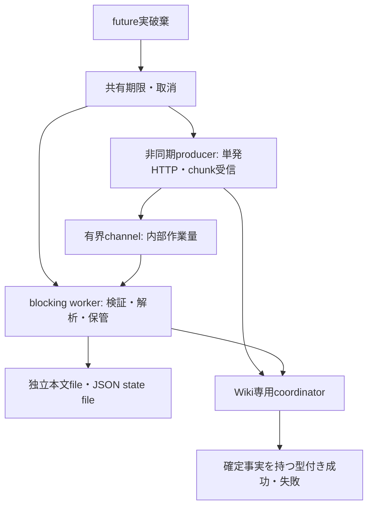

# Wiki単発RESTクライアントの詳細設計

## 1. 位置付けと実装状態

本書は[REQUIREMENTS.md](REQUIREMENTS.md)、[BASE_DESIGN.md](BASE_DESIGN.md)、
[CLI_SPECS.md](CLI_SPECS.md)、[CONFIG_SPECS.md](CONFIG_SPECS.md)に従う詳細設計である。
WikiClientの生成、lookup／read_source／read_meta、取消待機、逐次受信・保管・
JSON parserを実装し、ユーザー実行のcargo check／cargo testで検証済みである。
読取・受信の単体／模擬HTTP検証と、後続の実Wiki受け入れは区別する。
ドラフト作成、ロック取得／延長／解除、本文PUT、非再帰DELETEと秘匿ロック資源、
readonly送信workerを実装し、ユーザーCargo検証で機能試験が成功している。
試験コードの警告も是正し、警告なしの再ビルドと対象試験成功を確認した。
失敗観測の三分類、安全な実行側adapterと明示系列試験を保存した。
この追加分のcargo checkは警告・エラーなしで成功した。
不完POSTのfixture是正後、系列試験と全回帰の成功をユーザー実行結果で確認した。
通常モードExecutorは保存実装/静的確認とユーザーCargo検証が成功した。
MS4.3で単回障害再照合・累積操作警告/最終Report・実行CLI接続も実装した。
2026-10-22時点の通常回帰368成功/0失敗/16 ignoredと実Wikiの4代表は履歴とする。
後続の全入力/mode・追加ref・relay故障・実入力/停止の限定評価は
[CLI_SPECS.md](CLI_SPECS.md) の「現在の確認範囲」にまとめる。
通常回帰・個別実接続・制御・測定の成功を混算しない。

単発操作の要求・応答を型付けし、衝突モード、再照合の継続判断、ドラフト回収、
明示延長の開始判断をExecutorへ残す。mainは計画所有を引き渡し、
最終ReportはHTTP型/本文/leaseと独立した安全な所有値へ変換する。
計画成立前にWiki要求を行わない契約を維持する。

## 2. 公開境界と型

WikiClientは検証済みtarget、Wiki認証、共有StopContextとHTTP permitを受ける。
GitHub資格情報を受け取らず、global clientの設定・既存Git取得認証を変更しない。

| API | 単発の責務 |
| --- | --- |
| `lookup(path)` | 有効ID／404不存在／410削除済みの区別 |
| `read_source(id)` | 既存本文を検証・保管し、readonly所有者を返す |
| `read_meta(id, expected_path)` | 照会IDに対するmetadataと期待pathとの関係を返す |
| `create_draft(path)` | 本文なしPOSTから確定IDとロック資源を返す |
| `acquire_lock(id)` | ロック資源を取得する |
| `renew_lock(lease)` | 排他的な資源更新として期限・tokenを切り替える |
| `release_lock(id, lease)` | 明示的な単発解除。ドラフト解除の削除作用を隠さない |
| `put_source(id, lease, body)` | 検証済み計画のPlannedBodyを変換せず送る。amendは省略(false) |
| `delete_page(id, lease)` | 非再帰削除。recursiveは指定しない |

| 型 | 所有する情報・不変条件 |
| --- | --- |
| `LookupResult` | 検証済みPageIdまたは照会固有の不存在／削除済み |
| `PageMetadata` | 照会ID、path関係、current／last_deleted、deleted、locked、revision |
| `ReceivedBody` | 本文専用leaseと実バイト長。readonly Fileだけを公開 |
| `LockLease` | 独立した秘匿ULID token、RFC3339期限、使用可能性の状態。複製不可 |
| `DraftCreated` | 確定PageIdと成功時だけ公開するロック資源 |
| `PlannedBody` | 成立済みArc計画・本文位置・実量。任意File／pathから生成不可 |
| `WikiFailure` | 操作、失敗分類、送信段階、確定status・既知ID等の安全な事実 |
| `FailureBoundary` | sent/statusから導出する送信前・応答不確定・status観測済みの分類 |
| `ExecutionFailure` | 最終WikiFailure、caller指定ProcessingStage、順序付き先行事実のmove所有 |
| `OperationEvidence` | 先行WikiFailureとcaller確認済みObservedState。秘密資源は持たない |

metadataは`page_info.path.kind/value`、`deleted`、`locked`、
`revision_info.revision`等を選択抽出する。応答に存在しないid欄を要求せず、
照会に使用した検証済みIDを保持する。返却pathは巨大なStringへ収集せず、
期待pathとの一致／相違とkindへ写す。既存相対参照・PagePathの禁止要素は維持する。

IDはPageId、tokenは別の秘匿型とする。共通化できるのはULID形式検査だけであり、
tokenをPageIdや復旧IDへ変換しない。型のDebugは状態・サイズ・固定分類へ限定する。
本文、token、認証、保管path、外部エラーやraw headerを表示型へ保持しない。

## 3. HTTP・認証と送信の事実

Wiki専用reqwest clientは`retry(reqwest::retry::never())`、
`redirect(reqwest::redirect::Policy::none())`を明示する。
GETを含め3xxを単発失敗として扱う。URL/queryは値としてescapeし、
API応答に含まれるURLへ任意の後続要求を送らない。

Basic/Bearerは検証済みWiki認証だけを使用する。Authorizationと
`X-Lock-Authentication`は独立で、create/update/deleteはreadを暗黙包含しない。
LuWiki 0.9.32ではlookup/meta/source GETはread、draft POSTはcreate、本文PUTはupdate、
ページDELETEはdelete、取得/延長はcreateまたはupdate、解除はupdateを必要とする。
writeはread/create/update/delete等を包含する上位互換scopeである。
全modeの通常遷移を許可する集合と、各要求の必要scopeを区別する。同一skip等に
deleteまで一律要求する製品検査やscopeの自動付与は行わない。

Bearer prefix認可はpath指定時の最終pathと、ID指定時のcurrent/draft保持/last_deleted
pathへ適用される。既知IDも免除されず、lock認証や期限切れcleanupより前に判定する。
旧f668710基線のWrite固定要求/prefix適用差は過去の照合結果であり、現行契約ではない。
0.9.32の操作別scopeとPageAccessPolicyによる認可を原典で再照合した（第10節）。
クライアントはopaqueな認証値をそのまま送り、401/403を観測事実として保持する。
scopeをtoken文字列から推測せず、認可の回避やサーバー改修を行わない。

送信準備・permit待ち前後と送信開始直前に停止を確認する。
permitはtransportとblocking workerが共有所有し、受信・解析・worker終了まで保持する。
future実破棄でもworker側の所有を維持し、共通取消で追加HTTPを禁止する。
その場合のworker終了と所有領域回収は非同期に継続し、即時完了を保証しない。
送信・受信・保管・解析のphaseに新しい処理期限を与えない。

| 段階 | 型付き結果で保持する事実 |
| --- | --- |
| send future開始前 | 要求未開始。準備／I/O／停止の安全な分類 |
| send future開始後、確定応答なし | 変更済みの可能性を否定せず応答不確定。送信byte数を推測しない |
| status／header受信 | 確定statusと独立に検証できた情報を保持する |
| 正常JSON全体の検証後、lock header不正 | 既知IDを保持し、成功ロック資源は返さない |
| 本文途中失敗 | 受信済みstatusを失わず、未検証本文を成功値へしない |

`WikiFailure::boundary()`はNotStartedをBeforeSend、Startedかつstatusなしを
ResponseUncertain、StartedかつstatusありをResponseReceivedへ導出する。
ResponseReceivedはHTTP statusを観測した意味であり、全受信の完了・変更適用・
未適用の確定を意味しない。不正正常応答やheader後通信断にも同じ分類を使い、
元kind・status・送信状態・確定ID・有限診断を失わない。

HTTP応答拒否・サーバー応答不正・通信断は実行側の失敗であり、入力不正へ写さない。
同じ404/410でも初回path照会以外は失敗として返す。
再照合・再作成・lock解放の進行はこの単発結果を受けたExecutorが決める。

## 4. 共有取消の待機とworker寿命

StopContextはAtomicBoolと絶対期限を持ち、clone間で同じ`Arc<Notify>`も共有する。
`wait_stopped()`とreadonly `deadline()`を保存実装へ追加している。
既存Tokio sync featureを使い、別の実行contextを生成しない。

取消はsticky flag更新と全waiter通知を行う。待機側はNotify futureを
作り登録を有効にしてからcheckpointを確認し、通知と同じ絶対期限を待つ。
起床後もcheckpointする。登録と状態確認の順序により、待機開始と取消の
競合で通知を取りこぼさない。flagの読書きはAcquire／Releaseを使う。

permit・send・chunk・channel待機にこの待機を競合させる。取得後・送信直前も
checkpointし、到達後は再照合・自分の既存lock解放を含め追加HTTPを行わない。
応答と停止が競合しても取得済みの確定事実を捨てず、新しい要求は開始しない。
時計・deadline・取消の例外budgetや後処理猶予を設けない。

HTTP500や応答不正を正常に型付き失敗として返す際は、共通contextをcancelしない。
そこでcancelすると、まだ境界内でも再照合が禁止されるためである。
正常な成功／失敗結果の返却経路では取消guardを解除し、受信workerの失敗終了は
channel閉鎖等のoperation内終了で回収する。共有取消は期限・外部取消・future実破棄で通知する。

非同期producerとblocking workerの間は有界channelで接続する。
producer終了・破棄で送信側を閉じ、workerの待機readを解放する。
workerが所有するleaseや解析stateを呼出し側で先に削除しない。
期限時はworker終了を待つ契約を維持する。future破棄は取消通知であり、
即時停止・回収を保証しない。既存ZIP/Git checkpoint・guardとGitHub認証挙動を維持する。

Wiki受信coordinatorは既存source::run_blockingを無条件には流用しない。
既存helperにはJoinErrorでguard解除前に早期返却し、global取消を通知する経路がある。
これは取得側の契約として維持する。Wiki側はHTTP500・parser/I/O失敗・worker失敗が
型付き結果としてReadyになった場合、共通取消guardを解除して返す専用連携を持つ。
通常失敗の終了はchannel閉鎖・operation内の通知で回収し、必要なworker終了を確認する。
これにより残期限内のGET再照合を、単発失敗そのもののglobal取消で阻害しない。
期限・外部取消・coordinator futureの実破棄は共通取消を通知し、追加HTTPを禁止する。

型付き失敗の通常返却から共有取消への辺は設けない。operation内の終了と
資源回収を完了し、残期限内の後続判断を呼出し側へ返す。

## 5. 逐次受信と本文所有権

本文・JSON・error応答に固定受信量上限を追加せず、入力max_page_bytesを流用しない。
`response.chunk()`を使い、`json()`／`bytes()`／`text()`による全量収集を避ける。
producerはchunkを作業単位に分割して有界channelへ渡す。
内部buffer・channel容量は作業量であり、受信総量の拒否上限ではない。

Markdown workerは未完UTF-8列だけをcarryし、厳格UTF-8とU+FFFDを検査して
元bytesを専用fileへ書く。BOM・LF/CRLF・末尾改行を変換しない。
全受信・検証・I/Oと最後の停止確認に成功した場合だけReceivedBodyを返す。
元入力payloadとWiki受信領域を別所有者にし、事前本文と再取得本文も独立に保有できる。
後続はreadonly handleで比較し、表示・エラーへ本文を移さない。

失敗・EOF不正・停止・worker破棄で未完成領域を回収する。
ディスク不足はI/O失敗であり、新しい設定上限とは扱わない。
送信は`ProjectionPlan::upload_body(self: &Arc<Self>, index)`だけが生成する
PlannedBodyを受ける。任意File／path／bytesから生成する公開入口は設けない。
計画と検証済み本文の対応を保ち、入力・ValidatedInputの所有構造は維持する。
blocking upload workerがArc計画・readonly File・HTTP permitを実I/O終了まで所有する。
Streamは同時に一つのread要求だけを送り、64KiB以下の結果をoneshotで受ける。
同時prefetchや全量収集・本文の追加保存・文字列化はしない。
operation終了とStream破棄は同じlocal終了通知でworker待機を解除する。
通常返却はworker joinを確認し、join後も同じ絶対期限・取消を確認する。
future実破棄は共有取消を通知し、worker所有の計画・File・permitを先に回収しない。
実File I/Oの強制中断や即時回収は保証しない。

PUTのContent-Lengthには検証済み実byte長を使う。完了はworker読込量でなく、
Streamの返却で期待全byteを呼出し側へ渡した事実によって確認する。
最後のoneshot結果が未消費なら不完了とし、早期204でも成功扱いしない。
Content-LengthによるStream破棄ではEOFまでpollされない可能性があるため、
EOF未pollだけを失敗にしない。wire送信済みbyte数やサーバー受領量は推測しない。

保証するのはアプリケーションの解析・保管用メモリを応答全量に比例させないことである。
transport chunk、HTTP/TLS内部buffer、OS・thread・file管理まで含む絶対RSS上限は保証しない。
一時領域の実使用量・受信中の停止遅延は実入力で確認する。

## 6. JSONの選択抽出と作業量

標準collectは全応答を常駐させる。serde_json from_readerとIgnoredAnyでも、
巨大key／既知stringのscratchや未知値の深い入れ子でメモリが増える。
このため有限の必要fieldを選択抽出するストリームlexer／構造parserを分離する案とする。
一般JSON全体をValueへ変換せず、固定JSON-depth上限も追加しない。

- keyは有限個の既知名との逐次照合を行い、未知keyを全量Stringへ収集しない。
- stringはUTF-8・escape・surrogate pairを逐次検査する。未知stringは保持せず消費する。
- IDはULID形式として抽出する。形式固有の長さ検査を応答総量制限と混同しない。
- metadata pathは期待pathとの逐次比較と禁止要素検査へ写す。
  kind・booleanは有限値、必要revisionは検査済み整数として保持する。
- 未知numberは構文だけ逐次検査し、巨大桁列をStringや任意精度値へ収集しない。
- object/arrayのcontainer種別・区切り状態を一時fileのstackへ退避し、
  任意の深さに比例するframeをメモリ常駐させない。ここにも新しい深さ上限を設けない。
- 必須項目の欠落・型不正・重複による曖昧さ、未完EOF・末尾データを拒否する。
  未知項目は構造を検証して読み飛ばす。正常応答全体の検証後だけ成功値を公開する。

error bodyはraw reason/messageを保持しない。確定statusと分類を基本とし、
採用するfront matter kind/type・位置情報は有限型・数値だけへ選択抽出する。
不正error bodyでも既に確定したstatusを失わない。
受信・lexer・構造・選択抽出・保管を別に検証し、生の応答を診断へ出さない。

## 7. ロック形式・時刻・更新の資源契約

照合サーバーは`X-Page-Lock: expire=<RFC3339> token=<ULID>`を返し、
要求には`X-Lock-Authentication: token=<ULID>`を使う。
サーバーは通常5分後の期限を返し、延長時は期限と新ULIDを発行する。
クライアントが5分を仮定して期限を作り直さず、受信期限を解析する。
重複・欠落・不正header、RFC3339不正・受信時期限切れは停止する。
時計ずれ補正・猶予を加えない。延長開始の具体的時期はExecutorに残す。
受信時だけでなく、成功leaseの公開時とロック認証を伴う送信直前にも
有効期限・使用可能性を確認する。本文解析や待機の間に期限切れとなった
資源を送信に使わず、既知ID等の安全な事実を保持して停止する。

LockLeaseは作成元clientの内部識別と対象PageIdに結び、作成時の
認証・接続先context以外へ流用しない。同じclientの内部状態を共有するcloneと、
別に構築したclientを区別する。本文PUT・DELETE・延長・解除ではこの結合を
送信前に検査し、clientまたは対象IDが違えばHTTPを開始しない。
由来はCreatedDraft／Acquiredとする。取得204にはページ種別が含まれず、
サーバーが期限切れdraftにも新ロックを発行し得るためAcquiredを既存ページと推測しない。
CreatedDraftの解除204はDraftDeleted、Acquiredの解除204は
ReleasedWithPossibleDraftDeletionとして、解除確定とdraft削除可能性を区別する。
追加HTTPで由来を自動確認せず、自動解除がdraft削除になる境界を隠さない。
結合情報やtokenをraw URL・認証情報とともにDebug／Reportへ渡さない。

LockLeaseの旧tokenを失敗型へ格納する資源返却APIは設けない。
延長APIはleaseをawait中排他的に借用し、execute初回pollで使用可能性を
一旦失わせる状態遷移である。tokenを取り出す公開getter・Cloneを設けず、
延長終了／future破棄まで旧leaseを他の変更要求へ使用できないようにする。

| 延長結果 | lease状態と後続 |
| --- | --- |
| 送信開始前の失敗 | 旧leaseは資源所有者に残る。失敗値は秘密を持たない。延長失敗後のPUT/DELETEへは進まない |
| 正常204＋有効な新header | 新tokenと期限へ置換し、旧tokenを破棄して新leaseだけを使用可能にする |
| 送信開始後の通信断・500・期限／取消 | 更新済みか不明。旧tokenを使用可能へ戻さず、既知IDと安全な事実を保持して停止 |
| 正常204だが新header欠落／不正／期限切れ | 使用可能な新leaseなし。旧tokenへ戻さず停止 |
| 確定したHTTP拒否 | 使用不可のまま延長失敗で停止。statusだけから旧tokenの現在有効性や保持主体を推測しない |
| 送信開始後のfuture破棄 | 更新中の資源を使用不可とし、共有取消を通知する |

失敗・破棄のguardは、排他的借用を解放する前に不確定leaseを使用不可にする。
送信前失敗ではtoken資源は元の所有者に残り、WikiFailure／Failureの値へ移らない。
その後の既存lock解放可否は保持確実性と共有境界に従いExecutorが判断する。
期限・取消到達なら、自分のlockであっても解放HTTPを送らない。
ドラフト解除は削除になるため、自動解除・回収をしない。

延長以外も、排他的な使用中はleaseを他の要求へ渡さず、応答に従って更新する。

| 操作結果 | lease状態と後続 |
| --- | --- |
| source PUTの正常204 | サーバーが自動解放するため、旧leaseを失効・使用不可にする |
| ページDELETEの正常204 | 対象削除後の旧leaseを使用不可にし、再作成の新ID／leaseと区別する |
| 明示lock解除の正常204 | 旧leaseを使用不可にする |
| 送信前失敗 | 資源は元の所有者に残す。client／ID結合、期限・取消と使用可能性を再確認する |
| 完全PUT400拒否 | 保存前拒否の原典、完全error受信、client／ID結合、期限／取消を根拠に旧leaseを条件付き維持する |
| 送信後不確定、保持不明の拒否、不正成功応答 | 使用可能へ戻さず、確定した安全な事実を保持して停止する |

保持継続が確実な既存ページleaseの停止時解放は、期限・取消未到達と所有確実性に従う。
CreatedDraftは保持できても自動解除しない。Acquiredも非draft確定の証拠と扱わない。
完全PUT400でもupload workerの終了確認と最後の共有停止・期限確認までは
保持へ戻さない。join中の停止やworker失敗ではleaseを使用不可のまま返し、
判明したstatusと既知IDを保持する。
PUT403には保存後の解除失敗経路があるため、400以外の拒否は保持へ戻さない。
使用不可の資源は送信に使えず、
最終Reportへ秘密を移さない。これらはサーバーの応答と原典に基づく資源状態であり、
単発クライアントが停止後の再照合・解放を自動開始する契約ではない。

Report adapterはPageId・操作・分類・status等の安全な情報だけを受け、
LockLeaseやtoken資源を一切引数／返却値に含めない。POST後に確定したIDは
header不正でも保持できるが、解析候補や不確定なIDを確定復旧IDとして補わない。

## 8. 累積操作警告と最終Reportの契約

adapterは最終WikiFailureとcaller指定ProcessingStage、発生順のOperationEvidence列を
ExecutionFailureへmoveする。ReadSource等からReadExisting/Recheck/Reconcileを推測せず、
callerが段階を指定する。clientは警告の累積・再照合・継続判断を自動実行しない。

OperationEvidenceは元WikiFailureとcallerが確認したObservedStateを所有する。
Startedかつ（statusあり、またはstatusなしTransport）を受け付ける。対象外の元失敗も
Executorのretainedへ保持し、Option Noneで情報を捨てない。旧warning()はstatusなしを
Noneとするが、最終Report変換はこの投影を使わず元事実を直接参照する。
statusなしをResponseUncertainとして保持し、DNS/接続確立失敗等をDisconnectedと断定しない。
詳細operation/kind/sent/status/確定ID/安全な数値診断とcaller段階を保持する。
元adapter列の未指定段階Noneも推測で補完しない。

executor/report.rsはExecutionBatchの順序を保ち、本文/lease/HTTP要求/任意errorを
持たないReport専用FailureDetail/RecoveryFacts/ResultDetailsへ所有変換する。
PageOutcome::AppliedWithWarningは適用actionだけを持ち、PageResult.details.warningsへ
独立した累積操作警告を発生順に保持する。最終Failedでも先行DELETE警告を失わない。
警告数は起動Warning＋操作警告レコード数で、成功ページは適用actionへ一回だけ加算する。
主/補助/cleanupの診断を警告件数へ自動加算しない。

元主原因のstageと最後の試行stage、補助再照合失敗、cleanup失敗/試行、独立した
SafetyStopを別々に持つ。ReceivedOpenの元ReadSource/200/knownIDは局所失敗のcauseであり、
新たなHTTPや適用成功ではない。初期化/開始前停止、first_failure、拒否payloadも保持する。
NotExecutedへ混入した復旧事実を破棄せず不整合として拒否し、二重記録/識別子/警告/段階の
矛盾も元payloadを保持して終了1へ分類する。正常結果へ手動復旧を要求しない。

stdoutはページ結果/集計/確定復旧情報、stderrは起動/操作警告と主/補助/cleanup診断へ分離する。
一般Debug/DisplayはID/path/本文/秘密を隠し、明示復旧出力だけ検証済み識別情報を表示する。
loggerは件数と終了状態だけを補助記録する。終了優先順位は1→2→3→0で、
再作成PUTの目的状態確認後もAppliedWithWarningとSafetyStopを両立し、最終ページでも1となる。
先行成功/警告と後続未実行を維持し、自動再送/rollback/draft回収をしない。

旧明示系列fixtureによるadapter確認と、MS4.3の製品Report/実CLI接続の証拠は区別する。
後者も模擬HTTP/子プロセスCLIの代表確認であり、実Wiki障害の実証にはしない。

## 9. 保存実装・依存と検証

保存配置はwiki_clientと、types／transport／receive／json／store／lock／upload／adapterである。
lookup／read_source／read_metaは検証済みID・pathを受け、有限結果だけを返す。
受信pieceは64KiB以下、channel容量は1であり、受信総量・JSON depthの上限は設けない。
JSONの未知値を収集せず、stackは最大到達depth相当の高水位file容量とtop一つを保持する。
WikiClient生成は設定と共有contextの絶対期限一致を確認する。送信開始の事実は
execute futureの初回pollで記録し、未pollの停止はNotStartedとして返す。
mainは取得/検証/確定計画の所有を同じcontextでExecutorへ渡し、結果をReportへ接続する。
初期化前に全metadataを保存し、失敗時も成立計画や先行結果をpreflightへ戻さない。
六変更操作は保存実装があり、POSTだけ201、その他は204を正常statusとする。
POSTは完全JSON／正常EOFで確定したIDを、その後の停止やlock header不正でも保持する。
部分抽出だけのIDは復旧IDにしない。PUT／DELETE／解除204後も旧leaseを失効のまま保つ。
GETの正常結果には既存の最終停止確認を維持する。
最終Reportの元事実保持・集計・表示は第8節の実装へ接続している。

| 依存 | 理由・影響 |
| --- | --- |
| 共通StopContextのNotify待機 | 保存実装あり。permit/send/chunkを取消へ競合させ、既存worker checkpoint・guardを維持 |
| reqwest 0.13.5 stream feature | 独自StreamをBodyへ接続する。tokio/fs・tokio-util/ioとwasm向けoptional依存のfeature統合あり |
| Tokio 1.53.1 | 直接feature追加なし。fsはreqwestから有効、io-utilは既存TLSで有効。File I/Oは独自blocking workerが所有 |
| chrono 0.4.45直接依存 | default無効・stdだけ要求。RFC3339解析とSystemTimeのUTC比較。clock補正なし |
| futures-core 0.3.34直接依存 | default無効。独自Stream traitだけに使用 |

chrono／futures-coreは既存lock版へ固定した。保存済みCargo.lockにはroot直接依存への
追加、reqwestからtokio-util／wasm-streamsへのedge、wasm-streams 0.5.0の追加がある。
AI側でCargo.lockを書き換えず、ユーザーCargo実行で整合と機能試験成功を確認した。
既存GitHubのclient認証・retry・取得処理は変更せず、feature統合と通常回帰を確認する。
追加した変更HTTP19・lock3・upload4と計画型1の計27試験は成功した。
試験コードの不要なmutを除去後、警告なしの再ビルドと対象試験成功を確認した。
PUT400後のjoin中停止とworker終了失敗でも保持へ戻さない境界を含む。

追加した明示系列試験はPOST→PUT、ロック後の独立本文再取得と明示解除、
旧DELETE→新POST→新PUT、DELETE500→明示照会→POST失敗の四系列を含む。
各操作間で同じ絶対期限・共有取消による後続GET／POST／PUT／解放HTTP0を定義し、
応答中の停止でstatus・確定ID保持、lease失効とworker／permit回収を検査する。
通常失敗の共有取消非発火とfuture実dropの共有取消を分離する。
本文同時保有中とdrop後の領域、送信worker終了後の最終計画Arc回収も確認対象とする。
不完JSON／不正本文の既存受信・所有試験と、upload workerの実drop・join中停止等の
既存試験を維持する。静的確認ではUTF-8 BOMなし・LF・置換文字なし・Rust80桁、
安全な型所有と表示、関数文書と処理区切りコメントを確認した。
この系列試験追加時には依存・feature・Cargoファイルを変更していない。追加分のcargo checkと、
追加12試験を含む系列試験・全回帰はユーザー実行で成功を確認した。

検証は次の仕様境界を含める。

読取HTTP・JSON・共有停止の関連26試験は、ユーザー実行のcargo testで成功した。
cargo checkは警告・エラーなしで、既存回帰を含む実行対象も成功している。
巨大JSONのHTTP試験は通常pieceで各層の接続を確認する。別の小型Unicode試験では
test専用producer幅を1byteにしてchannelからlexerまでの分割を確定させる。
小型本文のHTTP試験も1byte幅でUTF-8 carryを確定させ、BOM・raw多byte・
LF/CRLF・末尾の保持、置換文字・未完UTF-8拒否と後続明示GETを確認する。
模擬サーバーのwrite分割だけではTCP再結合により受信境界を保証できない。
401/403試験は三読取操作のstatus・送信開始・既知ID保持と後続明示GETを確認する。
0.9.32のwriteを用いた正常遷移とprefix外metadata拒否はMS4.2の代表実証がある。
2026-10-22のZIP実CLIではBasic/Bearer通常・部分成功/明示再実行・事前actor lock409と、
旧削除後の再作成PUT400を代表確認した。後続のrelay故障では実上流適用と
下流500/喪失を分離して観測し、自然な内部500やディスク障害は未実証のまま残す。
細分scope専用tokenによる変更段階の全実比較を保証しない。
worker境界のI/O注入は保存処理前に型付き分類を返す試験であり、実保存I/O失敗や
ディスク故障の再現を証明しない。通常失敗の共通取消非発火と事実保持を検証する。

- Notify登録前／登録中／登録後、複数waiter、clone間共有、deadline。
- permit/send/chunk/channel中停止、期限後追加HTTP0、future破棄とworker終了後回収。
- 巨大未知key/string/depth/number、分割escape、UTF-8、surrogate pair、
  必須重複／欠落／型不正、末尾データ／未完EOF、stack I/O失敗。
- 本文多byte境界・BOM/LF/CRLF/末尾保持、入力上限と独立した既存本文受信、保管失敗・回収。
- 正常ID保持と不正lock header、送信前／後の延長失敗、新token切替、旧token再使用拒否。
- client／対象IDの誤結合時の送信0、PUT／DELETE／解除成功後のlease失効、
  保持が確実な拒否と不確定応答の区別、ドラフト自動解除0。
- HTTP500・parser/I/O・workerの型付き失敗でglobal取消を発生させず、
  残期限内の明示GET照会を阻害しないcoordinator。期限／外部取消／実破棄は追加HTTP0。
- Basic/Bearer・scope/lock独立、0.9.32のDELETE=delete/unlock=update、3xx追従0、再送0。
- POST→PUT、lock後再取得、DELETE→POST、500後照会のクライアント呼出系列。
  これをExecutorの継続判断・実Wiki受け入れ完了とは扱わない。
- ダミー認証・token・本文のDebug／エラー／ログ非露出、既存設定／Report／取得／CLI回帰。

コード変更後のCargoはユーザー実行とし、文書のみの反映では再実行しない。
旧実Wiki4代表は当時の合成caseの証拠として保持する。
後続の基本12組合せ、public/private・追加ref、二用途共用固定7ページ集合の
上限/時間/RSS/一時容量評価を、対象候補・実/模擬・観測主体を区別して追加した。
取消/future dropは制御試験と実期限を分け、実CLIのOS signal取消としない。
通常/measurement両構成のcheckと、2026-10-31候補の通常releaseと製品証拠の結合、
正式独立更新レビューを確認し、2026-11-01に受け入れた。
利用/復旧文書を含む最終差分と初期リリース判断は別に行う。
過去server起動物/埋込revisionと全build設定の直接証明は保証しない。
安全上限の数値定義は [CONFIG_SPECS.md](CONFIG_SPECS.md)、
証拠の出自と保証範囲は [LIMITS_AND_VALIDATION.md](LIMITS_AND_VALIDATION.md)、
手動復旧は [RECOVERY.md](RECOVERY.md) に従う。

## 10. 外部仕様と実装の照合基線

現在のLuWiki契約は0.9.32/local commit
`d14d25f5a668d832ccb5b9d22a596ea80fb7038a`の
[REST_API_SPECS.md](https://raw.githubusercontent.com/kwgt/luwiki/d14d25f5a668d832ccb5b9d22a596ea80fb7038a/docs/REST_API_SPECS.md)
とREST/auth/DB認可実装に基づく。2026-10-21のread-only再照合で隣Cargo version/HEADを確認。
操作別scope、write包含、ReadOnlyの独立制約、IDの保存path認可と403への変換を照合した。
lock tokenはULID、期限headerはRFC3339という資源契約も維持する。

旧commit `f6687104e39d9c3ee519e1e22f1746513366b45f`は旧設計時点の履歴として残す。
そのDELETE=create・変更RESTのWrite固定/prefix未適用の差を0.9.32へ流用しない。
MS4.2のユーザー指定0.9.32環境でtest-only ExecutorのBasic/Bearer通常全modeと
範囲外既知IDmetadata403を代表確認した。旧競合/部分成功は以前の環境の証拠である。
G7ではユーザーが同じ環境/領域を確認し、実CLIの通常・部分成功/再実行・事前lock409・
旧削除後PUT400の4入口が個別成功した（2026-10-22）。当時の実500/応答喪失は未実証で、
400拒否から代替実証したとはしない。後続のrelay試験では実上流の適用と
下流500/応答喪失を別に観測した。これは自然な内部障害や全wire位置の再現ではない。
稼働binary埋込みrevisionの直接証明、細分scope単独/全REST負例、
初回read後の実競合raceは、最新の代表成功から一律に保証しない。

reqwestは固定版0.13.5のlocal client／response／retry／redirect実装を照合した。
既定retryとredirect、および全量collectとchunkの差は
[ClientBuilder retry](https://docs.rs/reqwest/0.13.5/reqwest/struct.ClientBuilder.html#method.retry)、
[Response chunk](https://docs.rs/reqwest/0.13.5/reqwest/struct.Response.html#method.chunk)も参照する。
serde_json 1.0.151のlocal de/read実装でscratchと未知値のstack使用を確認した。
実装時も固定版・対象サーバーとの契約差分を確認する。

## 11. 実行側との所有・単回再照合と安全停止

Executorは成立済み計画をArcで所有し、取得/検証/計画の同じStopContext cloneで
WikiClientを生成する。比較workerはreadonly Fileと計画/独立ReceivedBodyを所有し、
実I/O終了までTempDirを回収しない。比較成功時は受信所有者を返し、事前/再取得本文を
独立保持する。両側64KiB以下の作業bufferを用い、全量String化、Unicode/BOM/改行変換や
Wiki受信量上限を追加しない。局所I/O/worker/停止はExecutorFailure::Localに閉じる。

初回prepareはlookup404/410だけを新規経路へ分岐し、draft POST→明示renew→PUTへ進む。
完全JSONで確定したIDだけを後続停止/不正lock header時にも保持する。POST喪失時は
ID/tokenを補完せず、path照会による探索や再POSTをしない。既存errorはlookupだけで拒否し、
update/overwriteの同一bytesはlockなしskip、相違はExistingDifferentへ旧情報を所有する。
同じArc計画/位置へ結合した通常処理はacquire→renew→meta→lookup→source/事前bytes比較→
renew→PUT/DELETEの順。非draft根拠はmandatory revisionを含むmeta成功から得る。
明示延長は操作区切りだけで、時間しきい値/5分仮定/並行heartbeatを加えない。

PUTのStartedかつ500/statusなし/不正2xxは停止kindを除いて同一contextで一度照合する。
lookup同ID→meta current/非deleted/期待path→sourceと入力のbytes一致を確認した場合だけ、
新規/updateは警告付き適用で通常継続できる。別ID/差/GET・比較失敗は元PUTを保持し停止する。
異なる本文からNotAppliedと因果推測せず、補助失敗とUnknown/部分観測を別に残す。

DELETE異常は旧ID meta→path lookupの順で照合する。元失敗がHttp/status500の完全応答で、
旧deleted/last_deleted/期待pathとpath404/410が揃った場合だけ再作成へ進む。
空/不正なエラーJSONはProtocol、切断はTransport等の元kindのままとし、500だけで許可しない。
通信状態不明や不正成功は、削除確認済みでも自動再作成しない。正常DELETEまたは旧ID metaの
削除観測をold_delete_confirmedへ保持し、falseは未確認、lock Noneも未確認のままとする。
path照会の履歴を再作成後の現在状態に補完せず、新ID/leaseへ旧lock観測を流用しない。

条件付き再作成は先行DELETE警告を新POST/renew/PUTの結果へ発生順に渡す。新POST失敗でも
旧ID/revision/削除観測を失わず、新PUTの目的状態確認後も独立したRecreationUncertainで停止。
AppliedWithWarningを架空のFailedに変えず、最後のページでも後続禁止/終了1を保持する。

停止時のcleanupは非draft/保持確実/Acquired/同client・ID/usableと共有境界が揃う旧leaseだけ。
完全PUT400の保持は既存clientが全受信/送信join/最終検査後に返すusableに従い、403/500/喪失や
remote lockedだけから自分の保持を再構築しない。cleanup_attemptedは関数呼出の事実で、
HTTP送信の証明ではない。主/補助/cleanupと最後段階を分け、取消後は解除も追加HTTP0。
旧token再利用、自動再送/rollback/draft回収をしない。Report変換は第8節、CLIは基本設計9節に従う。

通常/障害/Reportと、固定BearerでZIP/LocalGitをloopbackへ接続した実CLI代表は
ユーザーCargo検証済み。その後G7でZIP実CLIを実Wikiへ接続した4入口が個別成功した。
通常/部分成功/明示再実行、actor lock409、旧削除後PUT400と観測時点の旧soft-delete/新draftを
確認した。metadata GETの期限切れlock/draft cleanupは承認済みの潜在副作用として区別し、
期待外/不確定で追加解除/削除/復元をしない。この4入口は2026-10-22の証拠である。
後続の実上流適用/relay応答喪失、実期限後の追加HTTP0と事後本文適用は、
当時の証拠と区別して [CLI_SPECS.md](CLI_SPECS.md) に記す。
Reportが未実行/失敗でも未適用を保証せず、終了時の主/補助/cleanupと既知ID、
観測時点の旧soft-delete/新draft/lockを区別し、未知状態を推測しない。
